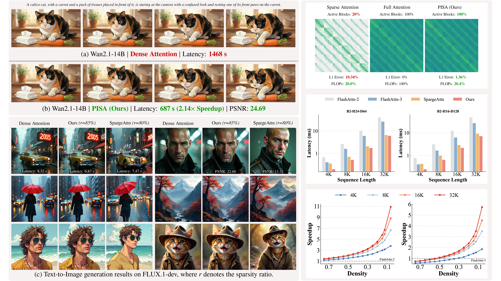

<div align="center">
    <h2>
        [NeurIPS 2026] PISA: Piecewise Sparse Attention Is Wiser for Efficient Diffusion Transformers
    </h2>
    <p>
        <a href="https://arxiv.org/abs/2602.01077"></a>
        <a href="https://huggingface.co/papers/2602.01077"></a>
        <a href="https://github.com/xie-lab-ml/piecewise-sparse-attention/blob/main/LICENSE"></a>
    </p>
</div>

<p align="center">
    
</p>


## 🔥 News
- **``2026/09/26``** **PISA** is accepted to **NeurIPS 2026** 🎉!
- **``2026/02/01``** [Paper](https://arxiv.org/abs/2602.01077) is released, introducing the **exact-or-approximate** paradigm for training-free sparse attention.


## 💡 TL;DR
We propose **PISA**, a training-free **Pi**ecewise **S**parse **A**ttention that covers the full attention span at sub-quadratic cost via lightweight compensation for skipped non-critical blocks.

Unlike the conventional ***keep-or-drop*** paradigm that directly drops unselected key-value blocks and loses global context at high sparsity, PISA establishes the ***exact-or-approximate*** paradigm: it preserves exact computation for critical blocks while recovering the skipped remainder through **block-wise Taylor expansion around block centroids** within a **unified online softmax**.


## 🔧 Installation
Requirements:
* `torch >= 2.10`
* `triton >= 3.6`


Install:
```shell
git clone https://github.com/hp-l33/piecewise-sparse-attention.git
cd piecewise-sparse-attention
pip install -e .
```

Note: Our kernels are currently primarily optimized for the NVIDIA Hopper architecture (e.g., H100, H800).

### Kernel variants

| API | Description |
|:----|:------------|
| `piecewise_sparse_attention_hyd` | The version corresponding to the paper. |
| `piecewise_sparse_attention_0th` | A simplified zeroth-order version that supports training. |

## 🎮 Quick Start
### Text-to-Image Generation
```diff
from diffusers import AutoPipelineForText2Image
+ from piecewise_attn import piecewise_sparse_attention
+ from piecewise_attn.models import FluxAttnProcessor, set_processor

pipeline = AutoPipelineForText2Image.from_pretrained(
    "black-forest-labs/FLUX.1-dev", torch_dtype=torch.bfloat16,
).to("cuda")

+ pipeline = set_processor(pipeline, piecewise_sparse_attention, density=0.15)

prompt = "A portrait of a human growing colorful flowers from her hair. Hyperrealistic oil painting. Intricate details."
image = pipe(
    prompt,
    height=1024,
    width=1024,
    guidance_scale=3.5,
    num_inference_steps=50,
    max_sequence_length=512,
).images[0]
```

Use the explicit variant names when switching implementations:

```python
from piecewise_attn import (
    piecewise_sparse_attention_0th,
    piecewise_sparse_attention_hyd,
)

# Paper version (the existing piecewise_sparse_attention alias points here).
out_hyd = piecewise_sparse_attention_hyd(q, k, v, density=0.15)

# Simplified trainable version.
q, k, v = (tensor.requires_grad_() for tensor in (q, k, v))
out_0th = piecewise_sparse_attention_0th(q, k, v, density=0.15)
out_0th.float().square().mean().backward()
```

### Attention sink for MMDiT

Both variants accept `sink_idx=None`, `0`, or `-1`. Setting it to `0` or `-1` forces the first or last K/V block into the exact top-k branch for every query block. For example, when an MMDiT such as HunyuanVideo places text tokens in the last block:

```python
from piecewise_attn import piecewise_sparse_attention_0th

out = piecewise_sparse_attention_0th(
    q,
    k,
    v,
    density=0.1,
    block_size=64,
    sink_idx=-1,
)
```

## 🌟 Awesome Works Following the Exact-or-Approximate Paradigm

Since **PISA** ([arXiv:2602.01077](https://arxiv.org/abs/2602.01077), Feb. 1, 2026) introduced the training-free **exact-or-approximate** paradigm—fusing exact critical-block attention with centroid-based block approximations inside a unified online softmax—a growing body of research and open-source projects has explored and extended compensated sparse attention:

- `2026/03` **[SVG-EAR](https://arxiv.org/abs/2603.08982)**: Combines SVG2's QK clustering with PISA's zeroth-order centroid approximation.
- `2026/07` **[Sol-Attn](https://arxiv.org/abs/2607.24027)**: Unifies routing and approximation with sparse attention in a single online-softmax pass.
- `2026/08` **[FlashPrefill V2](https://arxiv.org/abs/2608.19758)**: Brings block-mean compensation to LLM prefill serving.
- `2026/08` **[ClusterAttention](https://arxiv.org/abs/2608.26965)**: Combines PDDP-style QK clustering with zeroth-order centroid approximation.
- `2026/10` **[Piecewise-Taylor Attention (PWT)](https://github.com/HaoyiZhu/Piecewise-Taylor-Attention)**: Extends PISA with a second-order correction.
- `2026/11` **[TriTile](https://arxiv.org/abs/2610.35706)**, **[DecoupAttn](https://arxiv.org/abs/2611.05917)**, **[ESTRA](https://arxiv.org/abs/2611.10448)**, **[Token2Tile](https://arxiv.org/abs/2611.17930)**, **[PoCoAttn](https://arxiv.org/abs/2611.20307)**, **[Spark-H3](https://arxiv.org/abs/2611.24256)**: Further extend exact-or-approximate block compensation with QK clustering and other techniques.

*We sincerely thank the community for following up on and advancing the exact-or-approximate paradigm!*

## 🔗 BibTeX
If this work is helpful for your research, please give it a star or cite it:
```bibtex
@inproceedings{li2026pisa,
  title     = {PISA: Piecewise Sparse Attention Is Wiser for Efficient Diffusion Transformers},
  author    = {Li, Haopeng and Shao, Shitong and Zhong, Wenliang and Zhou, Zikai and Bai, Lichen and Xiong, Hui and Xie, Zeke},
  booktitle = {Advances in Neural Information Processing Systems (NeurIPS)},
  year      = {2026}
}
```
